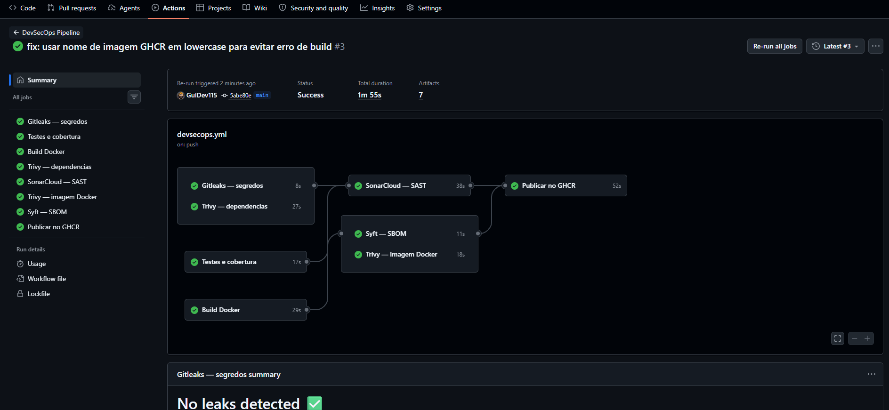
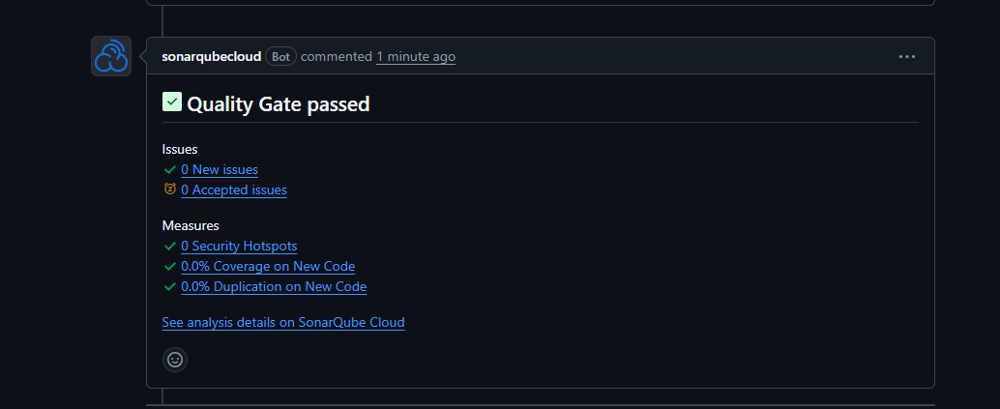
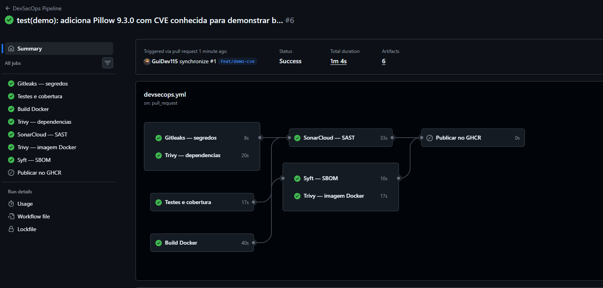
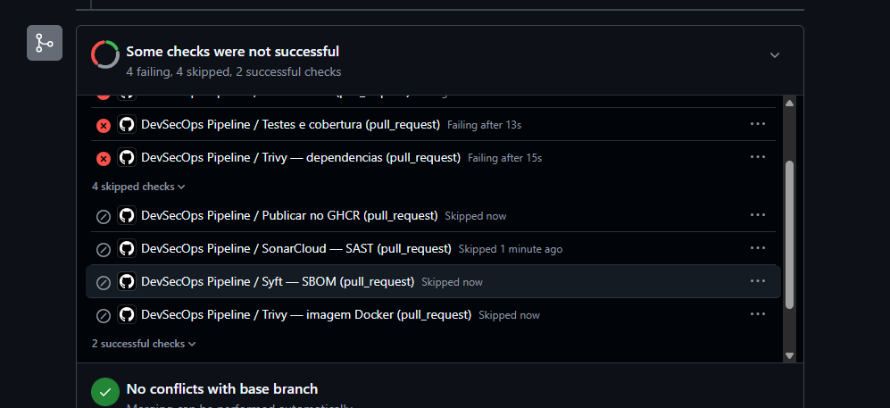
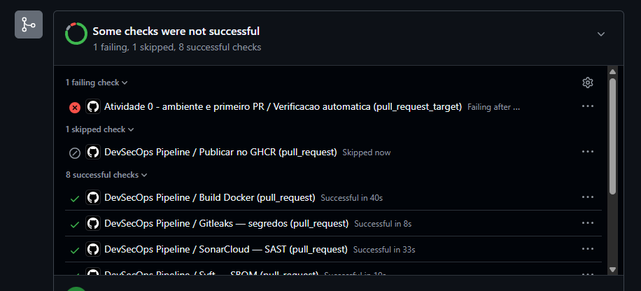

# Relatório — Trabalho Prático: Pipeline DevSecOps com GitHub Actions

**Disciplina:** DevOps na Prática — DCC / UFLA  
**Aluno:** Guilherme Fabrício (@GuiDev115)  
**Repositório:** https://github.com/GuiDev115/ufla-devops-shop

---

## 1. Visão Geral da Solução

O pipeline DevSecOps foi implementado no arquivo `.github/workflows/devsecops.yml` e integra cinco ferramentas de segurança ao fluxo de CI/CD existente. Todas as verificações executam automaticamente na abertura e atualização de Pull Requests. A publicação da imagem Docker no GHCR depende do sucesso de todos os checks obrigatórios.

### Arquitetura do pipeline

```
gitleaks ──────────────────────────────────────────────────────┐
test ──► sonarcloud ────────────────────────────────────────────┤──► publish
         ├──► trivy-deps ──────────────────────────────────────►┤    (push main)
         └──► build ──► trivy-image ────────────────────────────┤
                    └──► syft (SBOM) ───────────────────────────┘
```

---

## 2. Requisito 1 — Gitleaks: Detecção de Segredos

**Ferramenta:** `gitleaks/gitleaks-action@v2`  
**Comportamento:** varre o histórico completo do repositório (`fetch-depth: 0`) em busca de senhas, tokens e chaves. Bloqueia o PR ao detectar qualquer vazamento.

**Evidência — pipeline verde no main (Gitleaks: "No leaks detected"):**



---

## 3. Requisito 2 — SonarCloud: Análise Estática (SAST)

**Ferramenta:** `SonarSource/sonarcloud-github-action@master`  
**Configuração:** `sonar-project.properties` define o projeto, fontes (`app/`) e o relatório de cobertura (`coverage.xml`) gerado pelo pytest.  
**Comportamento:** bloqueia o PR quando o Quality Gate não é aprovado (zero Security Hotspots, zero bugs críticos em código novo).

**Evidência — Quality Gate aprovado:**



---

## 4. Requisito 3 — Trivy: Análise de Dependências e Imagem Docker

**Ferramenta:** `aquasecurity/trivy-action@master`  
**Duas varreduras:**

| Alvo | Severidade | Comportamento |
|---|---|---|
| Dependências Python (`requirements.txt`) | CRITICAL / HIGH com correção | Bloqueia (`exit-code: 1`, `ignore-unfixed: true`) |
| Dependências Python (`requirements.txt`) | LOW / MEDIUM | Registra em relatório JSON (artifact), não bloqueia |
| Imagem Docker construída | CRITICAL / HIGH com correção | Bloqueia |
| Imagem Docker construída | LOW / MEDIUM | Registra em relatório JSON (artifact), não bloqueia |

**Evidência — Trivy verde no pipeline principal:**


---

## 5. Requisito 4 — Syft: Geração de SBOM

**Ferramenta:** `anchore/sbom-action@v0`  
**Formato:** SPDX-JSON  
**Publicação:** gerado automaticamente como artifact `sbom.spdx.json` em cada execução do pipeline.

**Evidência — 6 artifacts gerados (incluindo SBOM) no run aprovado:**



---

## 6. Requisito 5 — Demonstração: Bloqueio e Correção

### 6.1 Branch de teste

Branch criada: `feat/demo-cve`  
Dependência vulnerável adicionada: `Pillow==9.3.0`

| CVE | Severidade | Descrição | Corrigida em |
|---|---|---|---|
| CVE-2023-44271 | HIGH | Uncontrolled Resource Consumption via TIFF | Pillow 10.0.1 |
| CVE-2023-50447 | HIGH | Arbitrary code execution via ImageMath.eval | Pillow 10.2.0 |

### 6.2 Pull Request bloqueado

PR aberto: `feat/demo-cve` → `main`  
O Trivy detectou as vulnerabilidades HIGH com correção disponível e bloqueou o merge.

**Evidência — checks do PR bloqueado (Trivy — dependencias: Failing):**



### 6.3 Correção aplicada

A dependência `Pillow==9.3.0` foi removida do `requirements.txt` (o app não necessita dela). Após o push da correção, o pipeline re-executou e todos os checks passaram.

**Evidência — pipeline verde após correção (run #6, Status: Success):**


**Evidência — PR aprovado: 8 checks bem-sucedidos:**



---

## 7. Regras de Bloqueio

| Ferramenta | Condição de bloqueio |
|---|---|
| Gitleaks | Qualquer segredo detectado no histórico git |
| SonarCloud | Quality Gate reprovado (código novo com problemas de segurança ou qualidade) |
| Trivy (deps) | Vulnerabilidade CRITICAL ou HIGH **com correção disponível** em `requirements.txt` |
| Trivy (imagem) | Vulnerabilidade CRITICAL ou HIGH **com correção disponível** na imagem Docker |
| Publicação GHCR | Falha em qualquer check acima |

Vulnerabilidades LOW e MEDIUM são registradas em relatório JSON e publicadas como artifact, sem bloquear o pipeline.

---

## 8. Artifacts por Execução

| Artifact | Conteúdo |
|---|---|
| `sbom.spdx.json` | Software Bill of Materials da imagem (formato SPDX-JSON, gerado pelo Syft) |
| `trivy-deps-report` | Relatório JSON de vulnerabilidades LOW/MEDIUM nas dependências Python |
| `trivy-image-report` | Relatório JSON de vulnerabilidades LOW/MEDIUM na imagem Docker |
| `coverage-report` | Relatório XML de cobertura de testes (usado pelo SonarCloud) |
| `docker-image` | Tarball da imagem Docker (compartilhado entre jobs) |
